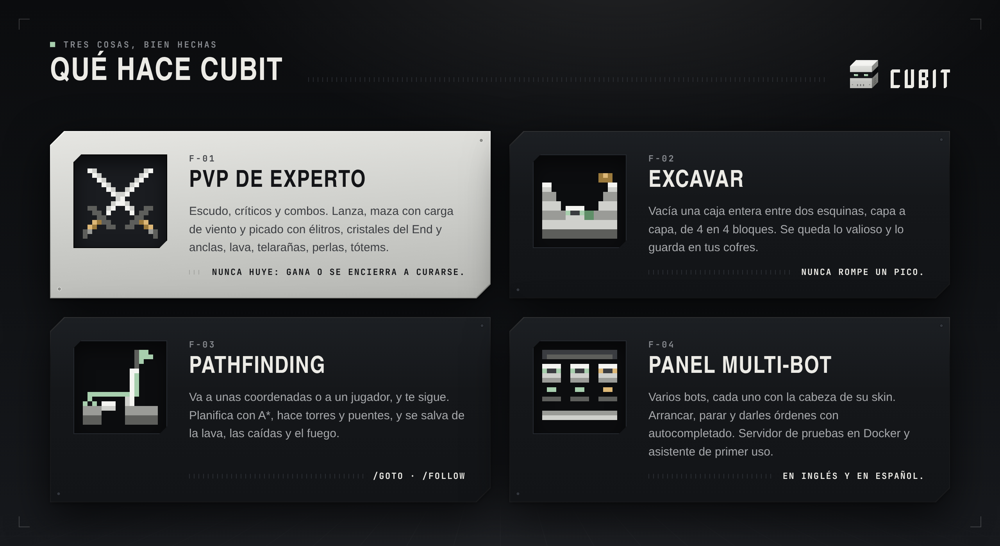
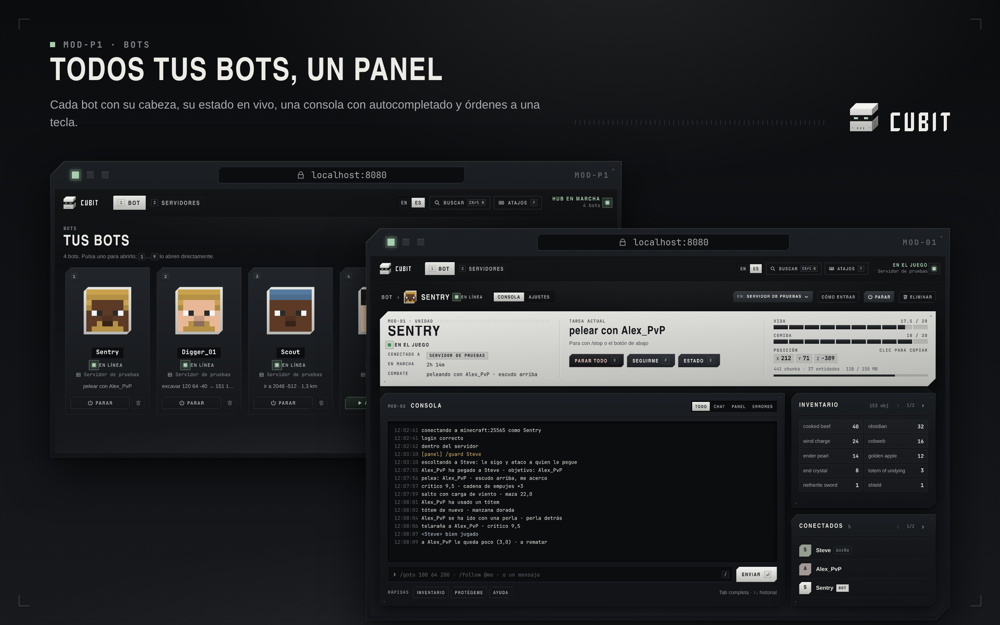
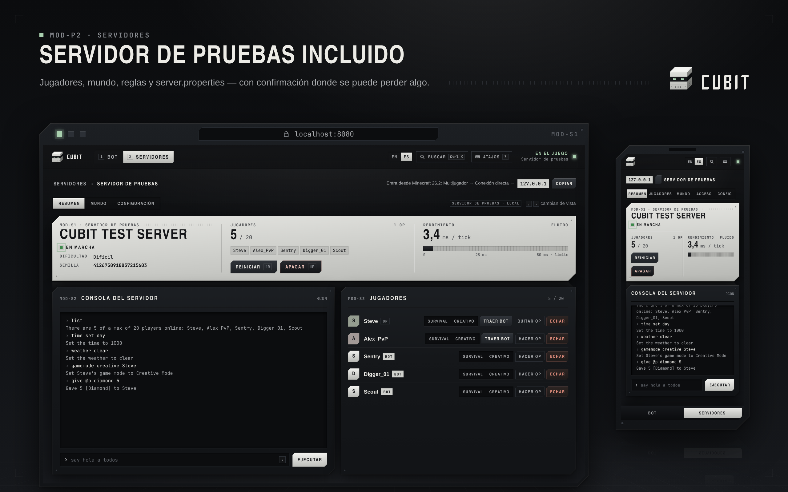
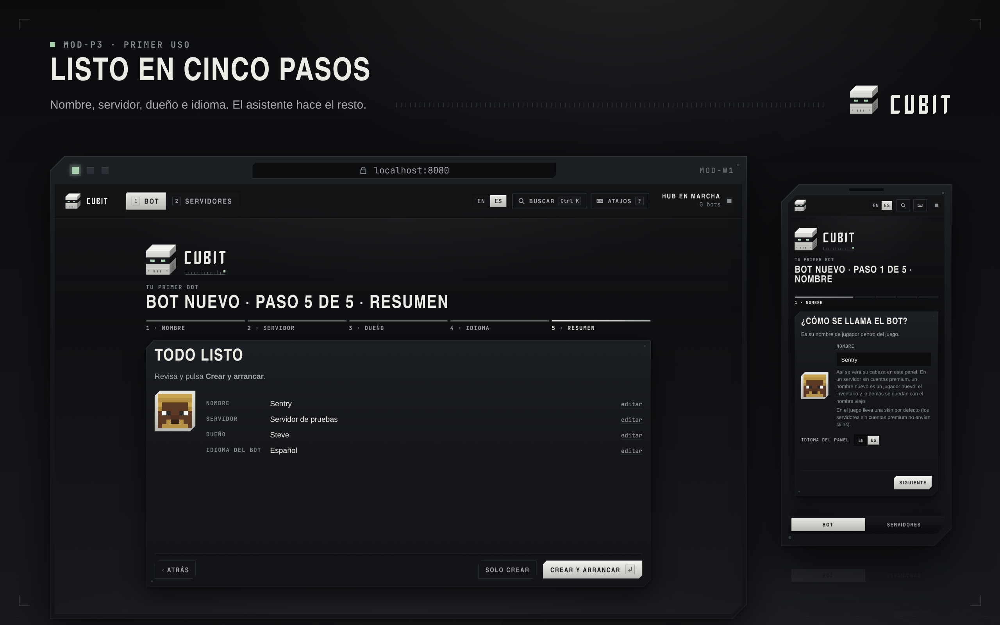
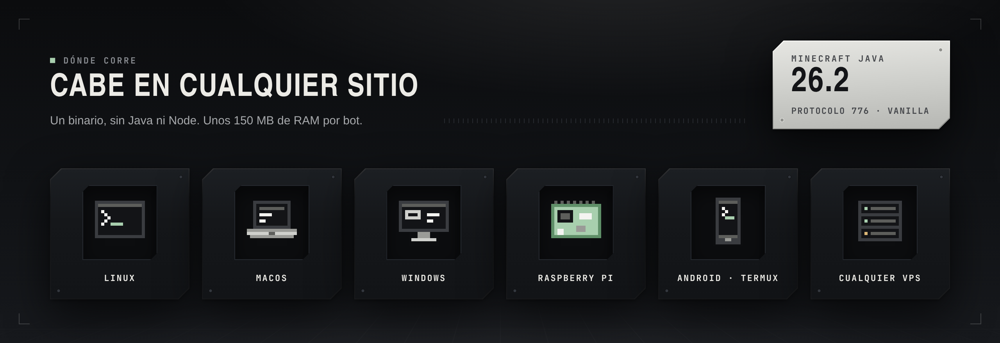
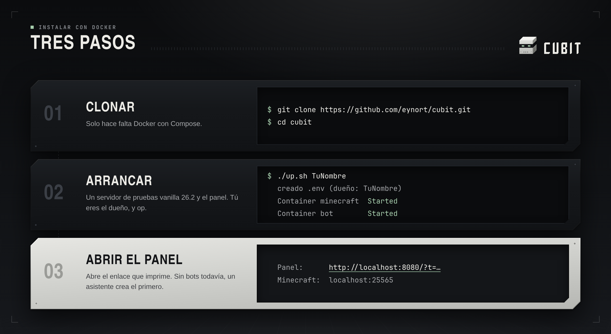

<p align="center"></p>

<p align="center">
  <b>Un bot de Minecraft que hace tres cosas, y bien: pelear, excavar y moverse.</b><br>
  Un solo programa en Go · un panel web para varios bots · Minecraft Java <b>26.2</b>
</p>

<p align="center">
  
  
  
  
</p>

<p align="center"><a href="README.md">English</a> · <a href="docs/ORDENES.md">Órdenes</a> · <a href="combat/PVP.md">Cómo pelea</a></p>

---

<p align="center"></p>

## Qué hace

- **PvP de experto.** Pelea con un jugador o con todos los de una zona, o te hace de guardaespaldas.
  - Espada y escudo con críticos, combos y buen momento para pegar.
  - La lanza, la maza (saltando con una carga de viento o en picado con élitros), los cristales del End y las anclas, la lava, las telarañas, las perlas, los tótems, el arco y el tridente.
  - De un jugador nunca huye: gana, o se encierra con bloques a curarse y vuelve.
- **Excavar.** Vacía una caja entera entre dos esquinas, de 4 en 4 bloques de alto, sin romper nunca un pico. Tira la basura y se queda lo valioso. Si le das cofres, guarda ahí lo valioso y coge de ellos picos nuevos.
- **Moverse.** Va a unas coordenadas o hasta un jugador, y te sigue. Busca el camino con A*, hace torres y puentes si hace falta, y se salva de la lava, las caídas y el fuego.
- **Un panel web para todos tus bots.** Cada bot sale con la cabeza de su skin. Puedes arrancarlos y pararlos, darles órdenes con autocompletado, cambiarlos de servidor y usar un servidor de pruebas integrado. El panel está en español e inglés.
- **Pequeño y vanilla.** Un solo programa en Go de unos 150 MB de RAM, sin Java ni Node. No usa comandos de plugins.

## El panel

<p align="center"></p>

| Servidores | Asistente del primer uso |
|---|---|
|  |  |

## Dónde corre

<p align="center"></p>

| | |
|---|---|
| **Minecraft** | Java Edition **26.2** (protocolo 776), servidores vanilla. Servidores en modo offline, o premium con una cuenta de Microsoft (`--microsoft`). |
| **Con Docker** | Linux, macOS o Windows (Docker Desktop, desde WSL). Trae el panel y un servidor de pruebas. |
| **Programa suelto** | Linux, macOS y Windows (amd64/arm64), Raspberry Pi, un VPS barato y Android con Termux. |
| **Memoria** | Unos 150 MB por bot (`--view` y `--memlimit` la bajan para móviles). |

## Instalación

<p align="center"></p>

### Opción A — Docker: el panel y un servidor de pruebas (recomendada)

Necesitas [Docker](https://docs.docker.com/get-docker/) con Compose. En Windows, Docker Desktop y una terminal de WSL.

```sh
git clone https://github.com/eynort/cubit.git
cd cubit
./up.sh TuNombreDeMinecraft
```

`up.sh` levanta un servidor de pruebas vanilla 26.2 y el panel, y al terminar escribe dos líneas:

```
  Panel:      http://localhost:8080/?t=…      ← abre esto (la clave va en el enlace)
  Minecraft:  localhost:25565                 ← Multijugador → Conexión directa
```

1. Abre el enlace del panel. Si no tienes bots, un asistente te pregunta el nombre del bot, el servidor (el de pruebas o cualquier otro), el dueño (tú) y el idioma.
2. Entra al servidor de pruebas desde Minecraft Java 26.2 en `localhost:25565`. Ahí eres op.
3. Dale órdenes desde la consola del panel, o por privado en el juego: `/msg TuBot follow me`.

`./up.sh logs` enseña lo que pasa, y `./up.sh down` lo para todo. Los puertos y demás ajustes están en `.env`.

### Opción B — el programa suelto (también en un móvil)

Descarga el de tu sistema en [Releases](../../releases), o compílalo con Go 1.27 o más nuevo:

```sh
go build -o cubit .
```

Y luego:

```sh
./cubit --name MiBot --owner TuNombre play.ejemplo.net   # entrar a un servidor
./cubit --monitor :8080 play.ejemplo.net                 # lo mismo, con el panel web
./cubit --demo                                           # probarlo sin servidor: un mundo de prueba dentro del programa
```

La próxima vez, `./cubit` sin nada entra al último servidor; lo que pongas se guarda en `bot.json`.

<details>
<summary><b>Android (Termux)</b></summary>

```sh
pkg install git golang
git clone https://github.com/eynort/cubit.git && cd cubit
go build -o cubit . && ./cubit --view 4 --memlimit 120 --name MiBot --owner TuNombre play.ejemplo.net
```
</details>

| Flag | |
|---|---|
| `<host[:puerto]>` o `--server` | El servidor; sin puerto, el del registro SRV o 25565 |
| `--name`, `--owner A,B` | El nombre del bot; quién puede darle órdenes (`*` = cualquiera, cuidado) |
| `--microsoft` | Servidor premium: entrar con una cuenta de Microsoft (un código, una sola vez) |
| `--monitor :8080` | El panel web (protegido con una clave) |
| `--hub :8080` | El panel para varios bots, cada uno en su proceso (lo que usa Docker) |
| `--view 6 --memlimit 150` | Memoria: distancia de visión y límite blando (para móviles) |

## Órdenes

| | |
|---|---|
| `/fight <jugador>` · `/fight in <x> <z> [<x2> <z2>]` | Pelear con un jugador, o con todos los de una zona |
| `/guard <jugador> [<minutos>]` | Seguir a un jugador y atacar a quien le pegue |
| `/excavate <x1> <y1> <z1> <x2> <y2> <z2> [exact]` | Vaciar esa caja (`/excavate chunk <y1> <y2>`: el chunk donde está) |
| `/excavate chests <x> <y> <z>` · `list` · `remove` · `clear` | Cofres donde `/excavate` guarda lo valioso y de donde coge picos |
| `/goto <jugador>` · `/goto <x> <z>` | Ir hasta un jugador o unas coordenadas |
| `/follow <jugador>` | Seguir a un jugador hasta `/stop` |
| `/inventory` · `/drop [<objeto> [<cantidad>]] [<jugador>]` | Ver lo que lleva; tirar o dar cosas |
| `/stop` · `/status` · `/say` · `/cmd` · `/lang` · `/sprint` · `/help` · `/quit` | Lo básico |

Los dueños se las mandan por privado en el juego: `/msg MiBot follow me`. La referencia completa está en [docs/ORDENES.md](docs/ORDENES.md). Sale de las mismas descripciones que el `/help` y el autocompletado del panel.

## Juega limpio

Úsalo en tu propio servidor o en los que permiten bots: muchos prohíben la automatización y los bots de PvP.

## Compilar y probar

```sh
go build .
go test ./...
go run . --gen-docs docs
```

El código está repartido en paquetes:
- `automation/`: excavar;
- `pathing/`: A* y movimiento;
- `combat/`: PvP (las notas de diseño están en [combat/PVP.md](combat/PVP.md));
- `safety/`: lava, caídas y fuego;
- `third_party/`: una librería del protocolo de Minecraft y un kit de bots incluidos en el repo (MIT, derivados de [Tnze/go-mc](https://github.com/Tnze/go-mc)).

Casi todos los tests corren en un mundo simulado determinista, sin servidor.

## Licencia

MIT. Cubit no es un producto oficial de Minecraft. No está aprobado por Mojang ni Microsoft, ni asociado con ellos.
