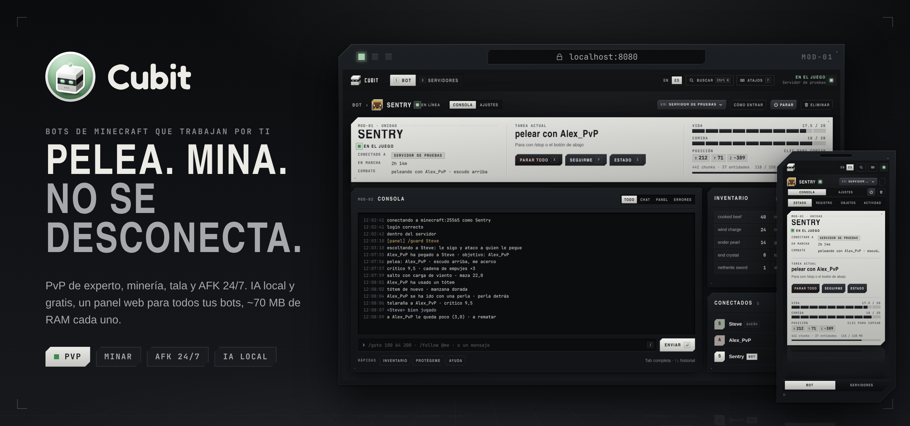

<p align="center"></p>

<h3 align="center">Bots de Minecraft que trabajan por ti.</h3>

<p align="center">Pelean, minan, talan y aguantan conectados las 24 horas, todo desde un panel web y con <b>~70 MB de RAM por bot</b>.<br>Sin programar, sin nube y sin claves de API.</p>

<p align="center">
  
  
  
  
  
</p>

<p align="center"><a href="README.md">English</a> · <a href="docs/GUIA.md"><b>Guía</b></a> · <a href="docs/ORDENES.md">Órdenes</a> · <a href="docs/API.es.md">API</a></p>

---

## Por qué Cubit

- **Listo para usar, no una librería.** Lo instalas, abres el panel, creas un bot y le das un trabajo. No escribes ni una línea de código.
- **Trabaja de verdad.** PvP de experto, excavación de zonas enteras, minería en ramas sin trampas, tala de árboles y AFK 24/7, todo de serie.
- **Ligerísimo.** Un solo programa de 17 MB, sin Java, Node ni nada que instalar. Unos 70 MB de RAM por bot: caben diez en 0,7 GB.
- **Háblale con normalidad.** Una IA opcional que corre **en tu propia máquina** (Ollama): gratis, sin cuentas ni claves de API, y nada sale de tu red.
- **Tuyo y en tu equipo.** Tus cuentas y tus bots se quedan en tu PC, una Raspberry Pi, un VPS de 5 $ o un Android viejo. Sin suscripciones ni servidores de terceros.

| | |
|---|---|
| **~70 MB** | de RAM por bot (75 MB en lo más fuerte de una pelea) |
| **0,7 GB** | diez bots a la vez |
| **17 MB** | un solo programa, sin Java, Node ni nada que instalar |

## Qué hace

**Trabajar**
- **Excavar.** Vacía una caja entera capa a capa, guarda lo valioso en tus cofres y nunca rompe un pico.
- **Minar.** En ramas, como un jugador de verdad: baja por una escalera a la mejor capa para cada mineral y abre túneles y ramas. Sin xray: solo pica lo que ve.
- **Talar.** Árboles enteros de las maderas que digas, también los de 2×2 y los del Nether, sin tocar las construcciones.
- **Cola de tareas.** Apunta trabajos (`/queue`, o encadénalos con ` ; `) y olvídate: los hace uno detrás de otro.

**Pelear**
- **PvP de experto.** Escudo, críticos y combos, la maza, cristales, perlas y tótems. Nunca huye.
- **Guardaespaldas y defensa de zona.** `/guard` a un jugador, o `/fight in` en una zona: quien entre, pelea.

**Seguir conectado**
- **AFK 24/7.** Se queda en un sitio día y noche: hace pequeños gestos para que no lo echen por inactivo, come, duerme de noche, se defiende de los mobs y vuelve andando tras morir o reconectar.
- **Vuelve solo.** Si el servidor se reinicia o se corta la conexión, entra otra vez y sigue con su trabajo y su cola. También responde al `/login` de AuthMe / nLogin.
- **Encuentra el camino solo** con A*, y hace torres y puentes si le hacen falta.

**Hablar y controlar**
- **Panel web para todos tus bots**, cada uno con su consola y autocompletado, y un servidor de pruebas integrado para jugar al momento (sin Docker).
- **Órdenes con palabras normales.** "mina 20 de hierro y tráemelo": la IA local lo convierte en órdenes. Opcional, por bot.
- **Discord.** Da órdenes con `/bot`, `/bots` y `/status`, y lee en un canal lo que dicen tus bots.
- **API HTTP con eventos en directo** para manejar tus bots desde tus propios scripts.

**Funciona en todas partes**
- Linux, macOS, Windows, Raspberry Pi y Android (Termux).
- En servidores de **otras versiones de Minecraft** entra a través de [ViaProxy](docs/GUIA.md#6-otras-versiones-de-minecraft).
- Servidores premium (online-mode) con tu cuenta de Microsoft, y todo en español o en inglés.

<p align="center"></p>

## Empieza en un minuto

**Windows**: con [Scoop](https://scoop.sh):

```powershell
scoop bucket add cubit https://github.com/eynort/cubit
scoop install cubit/cubit
```

Esto añade un acceso *Cubit* en el menú Inicio que abre el panel en tu navegador. O a mano: descarga `cubit-<versión>-windows-amd64.zip` en [Releases](../../releases), descomprímelo donde quieras y ejecuta `cubit.exe --hub :8080 --open` (crea una carpeta `data` junto a él para guardar ahí tus datos). No hay instalador: `cubit.exe` no está firmado, así que SmartScreen puede avisarte la primera vez: pulsa **Más información → Ejecutar de todas formas**, o compruébalo con `SHA256SUMS`. Un paquete de `winget install` llegará más adelante, cuando el proyecto esté publicado ahí.

**Linux**: un solo comando, sin root:

```sh
curl -fsSL https://github.com/eynort/cubit/releases/latest/download/install.sh | sh
```

O instala el `.deb` / `.rpm` de [Releases](../../releases) (`sudo apt install ./cubit_*.deb`, `sudo dnf install ./cubit-*.rpm`). Para dejar el panel siempre encendido: `systemctl --user enable --now cubit`.

**macOS** y **Android (Termux)**: descarga el programa de tu sistema en [Releases](../../releases) y ejecuta `./cubit --hub :8080 --open`.

Después:

1. **Entra al panel**: *Cubit* en el menú de aplicaciones lo abre en el navegador. El enlace lleva una clave de acceso (`?t=…`): copia el enlace entero.
2. **Crea tu bot**: el panel te guía paso a paso (nombre, servidor, dueño, idioma).
3. **Juega con él**: la primera vez, el panel te ofrece preparar un servidor de pruebas. En **Minecraft Java 26.2**, ve a *Multijugador → Conexión directa* y pon `localhost:25565`.

Para hablarle con palabras normales, instala [Ollama](https://ollama.com) una vez: el bot se baja su modelo solo (mira la [Guía](docs/GUIA.md#7-háblale-ia-local)).

### Avanzado: Docker

Si prefieres contenedores (así también se encienden el servidor de pruebas y Ollama), necesitas [Docker](https://docs.docker.com/get-docker/):

```sh
git clone https://github.com/eynort/cubit.git
cd cubit
./up.sh TuNombreDeMinecraft
```

Al terminar, te escribe el enlace de tu panel (`http://localhost:8080/?t=…`) y la dirección de Minecraft (`localhost:25565`).

## Instrucciones para usar el bot

Escribe las órdenes en la **consola del bot en el panel**. En el juego, mándaselas por privado siendo su dueño: `/msg MiBot follow Steve`. `~` es "donde está el bot", como en Minecraft.

**`/follow <jugador>`**: sigue a un jugador sin parar, hasta `/stop`.
```
/follow Steve
```

**`/goto <jugador>` · `/goto <x> <y> <z>`**: va hasta un jugador o hasta un bloque, y hace torres y puentes si le hacen falta. Si ese bloque está en el aire o bajo tierra, se para en el suelo más cercano de esa columna.
```
/goto Steve
/goto 120 64 -340
/goto ~50 ~ ~     → 50 bloques al este de donde está
```

**`/fight <jugador>` · `/fight in <x> <z> [<x2> <z2>]`**: pelea con un jugador hasta que uno de los dos muere, o con todo el que entre en una zona (un punto tiene un radio de 8 bloques, o da dos esquinas).
```
/fight Alex
/fight in 100 200             → todos a menos de 8 bloques de 100 200
/fight in 0 0 50 50           → todos dentro de ese cuadrado
```

**`/guard <jugador> [<minutos>]`**: modo guardaespaldas. Sigue a un jugador y ataca a quien le pegue.
```
/guard Steve
/guard Steve 30               → durante 30 minutos
```

**`/excavate <x1> <y1> <z1> <x2> <y2> <z2> [exact]`**: vacía la caja entera entre dos esquinas, de 4 en 4 bloques desde arriba. Nunca rompe un pico.
```
/excavate 10 70 10 30 50 30   → la caja entre esas dos esquinas
/excavate ~ ~ ~ ~15 ~-20 ~15  → un hoyo de 16×21×16 desde donde está
/excavate 0 60 0 15 40 15 exact → justo esos bloques (sin exact, ajusta la caja a chunks enteros)
/excavate chunk 0 64          → el chunk entero donde está, de la altura 0 a la 64
```

**`/excavate chests …`**: los cofres donde `/excavate` guarda lo valioso cuando se llena y de donde coge picos. Si le das uno de una pared de cofres, cuenta la pared entera.
```
/excavate chests 104 103 -224 → apuntar ese cofre
/excavate chests list         → verlos
/excavate chests remove 104 103 -224
/excavate chests clear        → olvidarlos todos
```

**`/mine <minerales> <x> <y> <z> [every <n>] [total <n>]`**: mina en ramas como un jugador de verdad, sin xray. Baja por una escalera a la mejor capa para ese mineral (diamante en y -59, hierro en 16…), hace un túnel con ramas cada 3 bloques y solo pica los minerales que de verdad ve. `x y z` es el cofre donde deja lo minado (cada 8 por defecto) y de donde coge picos. La mina empieza donde está el bot.
```
/mine diamond 104 64 -224              → diamantes, a ese cofre cada 8
/mine iron,copper ~ ~ ~ every 16       → una capa que vale para los dos, cofre donde está
/mine diamond 104 64 -224 total 32     → parar al llegar a 32
```

**`/chop <maderas> <x> <y> <z>`**: tala los árboles enteros de esas maderas a menos de 24 bloques de un punto, con la copa, y recoge los troncos. No toca construcciones (troncos sin hojas naturales, o pegados a tablones, cristal, puertas…). La `y` es la del suelo.
```
/chop oak ~ ~ ~                  → todos los robles de alrededor
/chop oak,birch 100 64 200       → robles y abedules alrededor de ese punto
/chop dark_oak,pale_oak ~ ~ ~    → también los árboles grandes de 2×2
/chop crimson,warped ~ ~ ~       → tallos del Nether
```

**`/afk [here | <x> <y> <z>]`**: se queda en un sitio las 24 horas hasta `/stop` (donde está, o primero va andando a las coordenadas). Cada 1-4 minutos hace algo pequeño (mirar alrededor, saltar, dar un paso y volver) para que el servidor no lo eche por inactivo, y vuelve al sitio si lo empujan. Come con hambre, se defiende de los mobs que se acercan, duerme en una cama a menos de 16 bloques de noche o con tormenta, y tras morir o reconectar vuelve andando al sitio.
```
/afk                          → quedarse aquí mismo
/afk 120 64 -340              → ir allí y quedarse
```

**`/ask <petición>`** (o mándale una frase por privado): palabras normales en vez de órdenes. La IA local planea las órdenes, las ejecuta y te contesta en el chat. Hace falta el asistente IA activado en los ajustes del bot y Ollama en marcha.
```
/ask mina 20 de hierro y tráemelo
/ask ¿qué tal vas?            → solo te contesta en el chat
```

**`/inventory [grid]`**: enseña lo que lleva: armadura, barra e inventario.
```
/inventory
/inventory grid               → colocado como en la pantalla del juego
```

**`/drop [<objeto> [<cantidad>]] [<jugador>]`**: tira todo, o un objeto, o va hasta un jugador y se lo tira.
```
/drop                         → todo, al suelo
/drop diamond                 → todos sus diamantes
/drop cobblestone 32          → 32 de piedra
/drop Steve                   → todo, tirado a Steve
/drop diamond 5 Steve         → 5 diamantes, tirados a Steve
```

**`/queue <orden>` · `<a> ; <b>`**: una lista de tareas. `/queue` apunta una orden (`chop`, `mine`, `excavate` o `goto x y z`) para cuando acabe la tarea actual. En cualquier línea, ` ; ` encadena órdenes: la primera empieza ya y las demás esperan su turno. Si una tarea falla o se rinde, el bot lo dice en el chat y pausa la lista; `/queue resume` sigue. La lista sobrevive a las reconexiones.
```
/queue /chop oak ~ ~ ~
/queue list                   → lo que espera, numerado
/queue remove 2               → olvidar la segunda
/queue clear                  → olvidarlas todas
/queue resume                 → seguir tras un fallo o un /stop
/mine iron ~ ~ ~ ; /chop oak 10 64 10   → minar ya, talar después
```

**`/stop`**: deja lo que esté haciendo: pelear, andar o excavar. También pausa la cola (guarda lo que espera; `/queue resume` sigue).
```
/stop
```

**`/status`**: vida, comida, posición y con quién pelea.
```
/status
```

**`/say <texto>`** (o escribe sin `/`): escribe en el chat del juego.
```
/say hola a todos
hola a todos
```

**`/cmd <comando>`**: ejecuta un comando del servidor como el bot (para la mayoría tiene que ser op).
```
/cmd time set day
/cmd tp Steve
```

**`/sprint on|off`**: le deja correr, o hace que ande siempre.
```
/sprint off
```

**`/lang en|es`**: el idioma de sus mensajes. Las órdenes son siempre en inglés.
```
/lang es
```

**`/help`**: la lista de órdenes. **`/quit`**: desconecta el bot y lo cierra.

La referencia completa, con todas las opciones, está en [docs/ORDENES.md](docs/ORDENES.md).

## Más información

- **[Guía](docs/GUIA.md)**: el panel, los servidores, Discord, los móviles, otras versiones y la IA local.
- **[Órdenes](docs/ORDENES.md)**: todas las órdenes y sus opciones.
- **[API HTTP](docs/API.es.md)**: lista los bots, mándales órdenes y sigue el chat y las tareas en directo desde tus scripts.
- **[Compílalo tú mismo](docs/COMPILAR.md)**: desde el código fuente.

Juega limpio: úsalo en tu propio servidor, o en servidores que permitan bots.

---

<sub>MIT. No es un producto oficial de Minecraft. No está aprobado por Mojang ni Microsoft, ni asociado con ellos.</sub>
