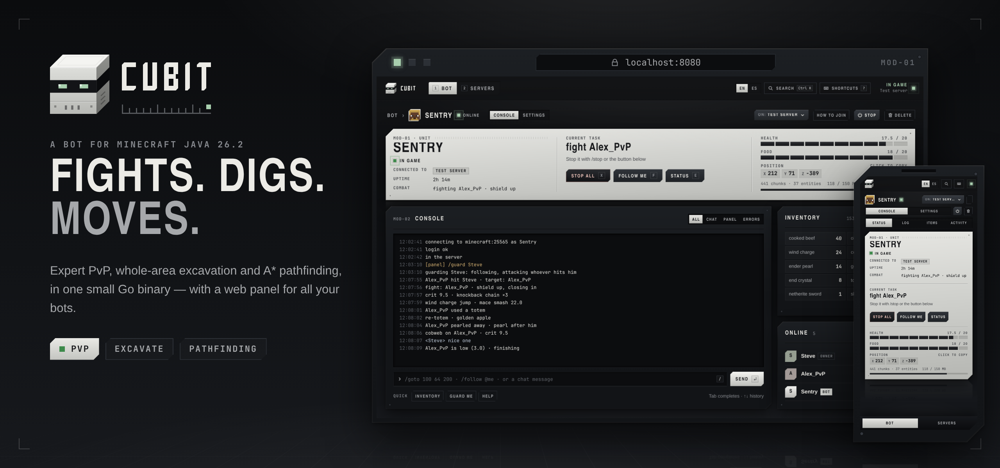
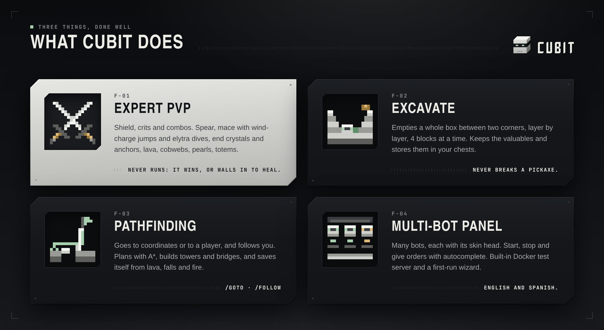
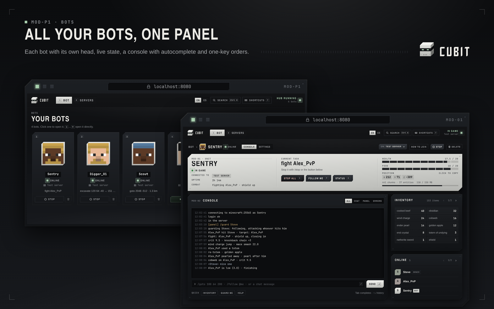
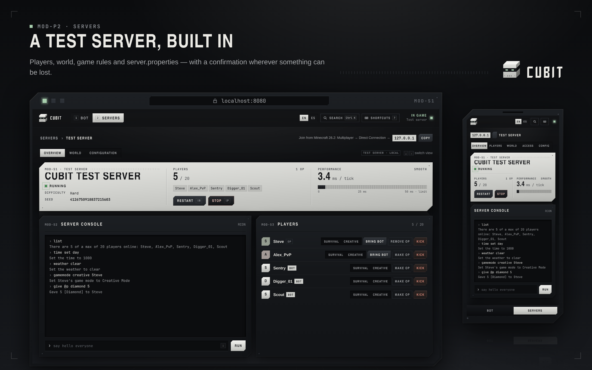
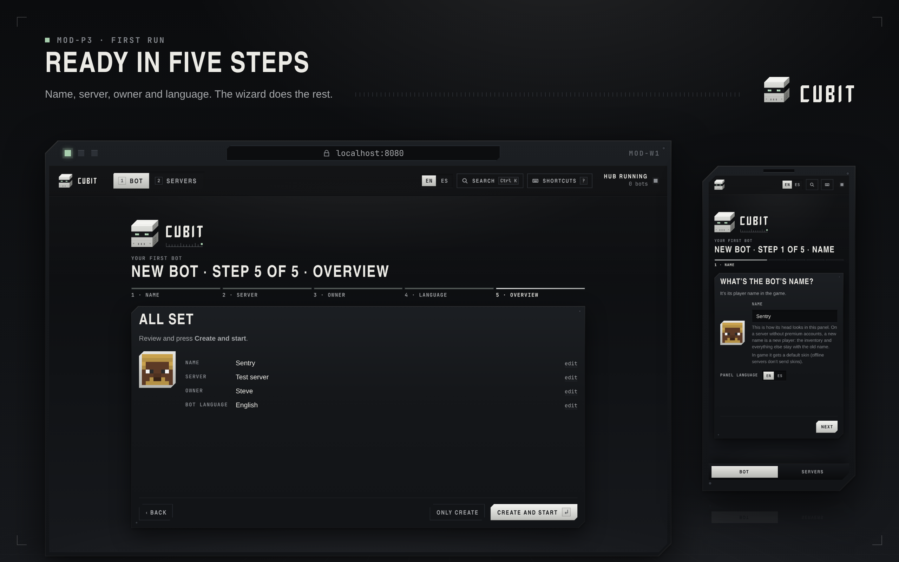
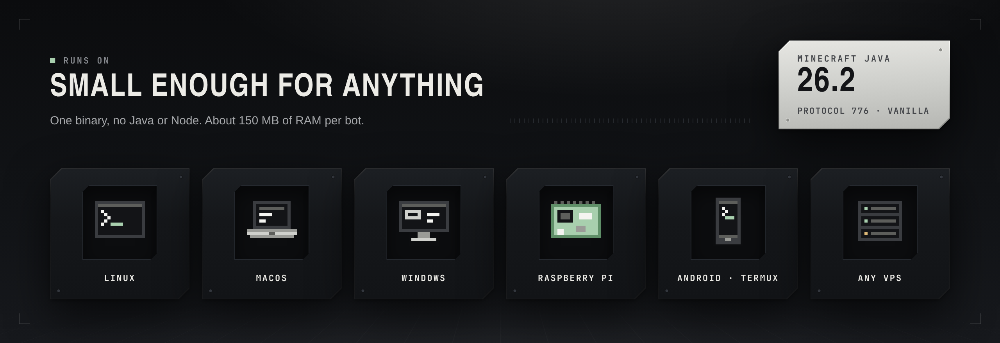
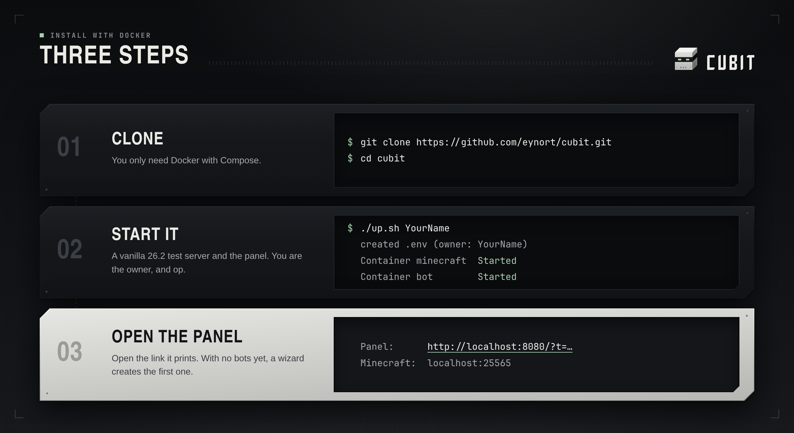

<p align="center"></p>

<p align="center">
  <b>A Minecraft bot that does three things, and does them well: fight, dig and move.</b><br>
  One small Go binary · a web panel for many bots · Minecraft Java <b>26.2</b>
</p>

<p align="center">
  
  
  
  
</p>

<p align="center"><a href="README.es.md">Español</a> · <a href="docs/COMMANDS.md">Commands</a> · <a href="combat/PVP.md">How the PvP works</a></p>

---

<p align="center"></p>

## What it does

- **Expert PvP.** It fights one player or everyone in an area, or guards you.
  - Sword and shield with crits, combos and hit timing.
  - The spear, the mace (wind-charge jumps and elytra dives), end crystals and respawn anchors, lava, cobwebs, ender pearls, totems, bows and tridents.
  - It never runs from a player: it wins, or walls itself in to heal and comes back.
- **Excavate.** It empties a whole box between two corners, 4 blocks high at a time, and never breaks a pickaxe. It throws the junk away and keeps the valuables. Give it chests and it stores the valuables there, and takes fresh pickaxes from them.
- **Move.** It goes to coordinates or to a player, and follows you. It plans paths with A*, builds towers and bridges when needed, and saves itself from lava, falls and fire.
- **A web panel for all your bots.** Each bot shows its skin head. You can start and stop them, give orders with autocomplete, switch servers, and run a built-in test server. The panel is in English and Spanish.
- **Small and vanilla.** One Go binary of about 150 MB of RAM, with no Java or Node. It uses no plugin commands.

## The panel

<p align="center"></p>

| Servers | First-run wizard |
|---|---|
|  |  |

## Where it runs

<p align="center"></p>

| | |
|---|---|
| **Minecraft** | Java Edition **26.2** (protocol 776), vanilla servers. Offline-mode servers, or premium servers with a Microsoft account (`--microsoft`). |
| **With Docker** | Linux, macOS, or Windows (Docker Desktop, run from WSL). You get the panel and a test server. |
| **Single binary** | Linux, macOS and Windows (amd64/arm64), Raspberry Pi, a cheap VPS, and Android through Termux. |
| **Memory** | About 150 MB per bot (`--view` and `--memlimit` go lower for phones). |

## Install

<p align="center"></p>

### Option A — Docker: the panel and a test server (recommended)

You need [Docker](https://docs.docker.com/get-docker/) with Compose. On Windows, use Docker Desktop and a WSL terminal.

```sh
git clone https://github.com/eynort/cubit.git
cd cubit
./up.sh YourMinecraftName
```

`up.sh` starts a vanilla 26.2 test server and the panel, then prints two lines:

```
  Panel:      http://localhost:8080/?t=…      ← open this (the key is in the link)
  Minecraft:  localhost:25565                 ← Multiplayer → Direct Connection
```

1. Open the panel link. With no bots yet, a wizard asks for the bot's name, the server (the test server, or any other), the owner (you) and the language.
2. Join the test server from Minecraft Java 26.2 at `localhost:25565`. You are op there.
3. Give orders from the panel console, or whisper them in game: `/msg YourBot follow me`.

`./up.sh logs` shows what is happening, and `./up.sh down` stops everything. Ports and other settings live in `.env`.

### Option B — a single binary (also on a phone)

Download the file for your system from [Releases](../../releases), or build it with Go 1.27+:

```sh
go build -o cubit .
```

Then:

```sh
./cubit --name MyBot --owner YourName play.example.net   # join a server
./cubit --monitor :8080 play.example.net                 # the same, with the web panel
./cubit --demo                                           # try it with no server: a test world inside the program
```

Next time, `./cubit` alone joins the last server; whatever you set is saved in `bot.json`.

<details>
<summary><b>Android (Termux)</b></summary>

```sh
pkg install git golang
git clone https://github.com/eynort/cubit.git && cd cubit
go build -o cubit . && ./cubit --view 4 --memlimit 120 --name MyBot --owner YourName play.example.net
```
</details>

| Flag | |
|---|---|
| `<host[:port]>` or `--server` | The server; without a port, the SRV record's or 25565 |
| `--name`, `--owner A,B` | The bot's name; who may give it orders (`*` = anyone, careful) |
| `--microsoft` | Premium server: join with a Microsoft account (a code, once) |
| `--monitor :8080` | The web panel (protected by a key) |
| `--hub :8080` | The panel for several bots, each in its own process (what Docker uses) |
| `--view 6 --memlimit 150` | Memory: view distance and soft limit (for phones) |

## Commands

| | |
|---|---|
| `/fight <player>` · `/fight in <x> <z> [<x2> <z2>]` | Fight a player, or everyone in an area |
| `/guard <player> [<minutes>]` | Follow a player and attack whoever hits them |
| `/excavate <x1> <y1> <z1> <x2> <y2> <z2> [exact]` | Dig out that box (`/excavate chunk <y1> <y2>`: the chunk it stands in) |
| `/excavate chests <x> <y> <z>` · `list` · `remove` · `clear` | Chests where `/excavate` stores the valuables and takes pickaxes from |
| `/goto <player>` · `/goto <x> <z>` | Go to a player or to coordinates |
| `/follow <player>` | Follow a player until `/stop` |
| `/inventory` · `/drop [<item> [<amount>]] [<player>]` | See what it carries; drop or give things |
| `/stop` · `/status` · `/say` · `/cmd` · `/lang` · `/sprint` · `/help` · `/quit` | The basics |

Owners whisper them in game: `/msg MyBot follow me`. The full reference is in [docs/COMMANDS.md](docs/COMMANDS.md). It comes from the same descriptions as `/help` and the panel's autocomplete.

## Play fair

Use it on your own server, or on servers whose rules allow bots: many forbid automation and PvP bots.

## Building and testing

```sh
go build .
go test ./...
go run . --gen-docs docs
```

The code is split into packages:
- `automation/`: excavate;
- `pathing/`: A* and movement;
- `combat/`: PvP (the design notes are in [combat/PVP.md](combat/PVP.md));
- `safety/`: lava, falls and fire;
- `third_party/`: a vendored Minecraft protocol library and bot kit (MIT, derived from [Tnze/go-mc](https://github.com/Tnze/go-mc)).

Almost every test runs in a deterministic simulated world, with no server.

## License

MIT. Cubit is not an official Minecraft product, and it is not approved by or associated with Mojang or Microsoft.
